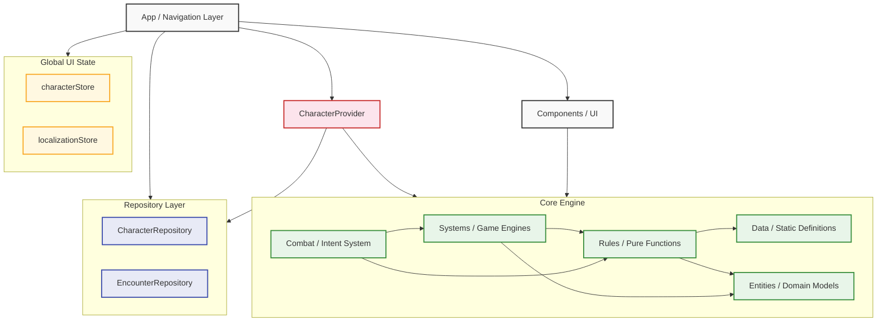

# System Architecture

The D&D Companion utilizes a modular, layered clean architecture design. This separates the presentation layer (UI) from the infrastructure and isolates the core D&D game logic into an independent engine.

## High-Level Dependency Graph



## Layer Definitions

### 1. App (`src/app`)

Handles application routing, navigation stacks (using Expo Router), and global providers. It dictates _where_ a user goes. Screens receive their data from the `CharacterProvider` context rather than reading from repositories directly.

### 2. CharacterProvider (`src/utils/character-provider.tsx`)

The runtime join layer between the `Character` record and the `EncounterState`. Responsible for:

- Loading the character from `CharacterRepository` on mount.
- Loading or bootstrapping the character's encounter from `EncounterRepository`.
- Hydrating `character.combatState` from `encounter.participants[characterId]` before passing data to screens.
- Exposing `saveCharacter` and `saveEncounter` so screens can persist mutations through the correct repository without direct storage access.

All combat screens consume data exclusively through `useCharacter()`, which returns `{ character, encounter, saveCharacter, saveEncounter, loading }`.

### 3. Repository Layer (`src/repositories`)

Abstractions over AsyncStorage, one per domain entity. They are the only layer permitted to read from or write to persistent storage directly.

| Repository | Responsibility |
|---|---|
| `CharacterRepository` | CRUD for the `Character[]` list; calls `hydrateCharacter()` on every read |
| `EncounterRepository` | CRUD for `EncounterState` records, keyed by encounter ID; lookup by participant character ID |

Repositories are plain objects with async methods. They contain no business logic and no React dependencies.

**Character hydration**: `hydrateCharacter()` in `src/repositories/character-migration.ts` must be called on every raw AsyncStorage read. `CharacterRepository` does this automatically. Dynamic maps (`features`, `resources`, `actions`, `statModifiers`, `featureChoices`) default to `{}` wholesale on migration — never deep-merged.

### 4. Store (`src/store`)

Zustand stores for UI-level state only.

| Store | Responsibility |
|---|---|
| `characterStore` | Persists `selectedCharacterId`; full character data lives in repositories |
| `localizationStore` | Active locale and i18n string map |

Encounter state and combat state are **never** held in Zustand stores.

### 5. Components (`src/components`)

Reusable, stateless UI atoms and molecules (Buttons, Text, Cards). They receive data and callbacks as props and contain no storage or navigation logic.

### 6. Core Engine (`src/core`)

The isolated D&D Engine. Its architecture guarantees that the game mechanics can be tested, simulated, or exported to a backend server without any React dependencies.

- **Entities** (`src/core/entities/`): Pure TypeScript types only. Zero logic, zero functions. Defines the shapes that data conforms to and that the engine operates on.
- **Data** (`src/core/data/`): Concrete instances of entity types — the registered templates, static game content, registries, and scaling tables. Still no logic, but contains the specific D&D content.
- **Rules** (`src/core/rules/`): Pure functions that compute things. Takes state/templates as input, returns derived values or new state. No side effects, no React, no storage.
- **Systems** (`src/core/systems/`): Orchestrators that apply state transformations over time, spanning multiple rules calls (`StatResolver`, `CombatEngine`, `ModifierEngine`, `SnapshotManager`).
- **Combat** (`src/core/combat/`): The intent-based action resolution pipeline (`IntentQueue`, `IntentResolver`, `ReactionSystem`). Sits above Systems — it uses the rule execution graph but is not part of the Systems orchestration layer.

### Layer boundary rules

| What it is | Layer | Path pattern |
|---|---|---|
| Type or interface defining a shape | `entities/` | `entities/rules/thing-template.ts` or `entities/character/thing-instance.ts` |
| Static D&D content (a specific feature, option, pool) | `data/` | `data/rules/options/{class}/thing.ts` |
| Registry (lookup by id, homebrew extension point) | `data/registries/` | `data/registries/things.registry.ts` |
| Pure function (calculate, build, resolve) | `rules/` | `rules/character/things-helper.ts` |
| Multi-step orchestration, stateful operations | `systems/` | `systems/combat/thing-system.ts` |
| Intent routing, reaction windows | `combat/intents/` | `combat/intents/intent-resolver.ts` |

---

## Key Architectural Rule: State Ownership

`CombatState` is owned by `EncounterState`, not by `Character`. The `Character` record stored in AsyncStorage does not contain `combatState`. It is injected at runtime by the `CharacterProvider` after loading the encounter. This means:

- Screens read `character.combatState` freely — the provider guarantees it is populated by the time any combat screen renders.
- Screens must **not** call `saveCharacter` to persist combat state changes (action economy, round tracking, runtime modifiers). Those go through `saveEncounter`.
- Screens must **not** construct `EncounterState` inline. The provider owns encounter construction and lifecycle.

---

## Key Architectural Rule: Dual-Source Feature Pipeline

A character's active capabilities (actions, resources, modifiers, proficiencies, languages, advantages) are derived from two independent sources that feed the same resolution pipeline:

1. **Class/subclass levels** — `getFeaturesFromClasses(character.classes)` walks `featuresByLevel` on each class and subclass template up to the character's current level.
2. **Direct character features** — `getFeaturesFromCharacter(character.features)` resolves `FeatureInstance` records held directly on the character. This covers homebrew feats, racial features, training features, and any capability granted outside the class level pipeline.

Both sources produce `FeatureTemplate[]` which feed into the same `grants` resolution pipeline. A homebrew feature granting `cunning_action` is resolved identically to the Rogue class feature — no special cases.

`getActiveFeatures(character)` is the single entry point that merges both sources. All build functions call this rather than reading `character.classes` directly.

---

## Key Architectural Rule: Feature Grants

`FeatureTemplate` expresses what a feature provides through a single `grants?: FeatureGrant[]` array. The `FeatureGrant` discriminated union currently supports:

```ts
type FeatureGrant =
  | { type: "resource"; id: string }
  | { type: "action"; id: string }
  | { type: "modifier"; id: string }
  | { type: "choice"; id: string }           // references a ChoicePoolTemplate id
  | { type: "proficiency"; nodeId: string }  // grants proficiency at a CheckNode
  | { type: "language"; nodeId: string; modes: LanguageMode[] }
  | { type: "advantage"; nodeId: string; polarity: AdvantagePolarity; condition?: Condition };
```

Adding a new grant kind requires a one-line addition to the union and a new filter in the relevant helper — no structural changes to `FeatureTemplate` itself. Use the `grantsOfType(feature.grants, "x")` helper from `src/core/rules/shared/grant-filters.ts` rather than inline filtering — it provides proper TypeScript narrowing.

---

## Key Architectural Rule: Optional/Selectable Features

Features that offer a pool of options the character picks from (Fighter Maneuvers/Runes, Eldritch Invocations, Metamagic, Fighting Styles) are modeled through three cooperating types:

- **`ChoicePoolTemplate`** — defines the pool: which options it contains, how many picks the character gets at each level (`picksAtLevel: Record<number, number>`), and when selection happens (`selectionTrigger`).
- **`OptionTemplate`** — defines a single selectable option. Its `grants` field is `OptionGrant[]`, which is `Exclude<FeatureGrant, { type: "choice" }>` — all grant variants except `choice`, preventing circular resolution.
- **`ChoiceInstance`** — runtime character state recording which options have been selected from a given pool, stored on `character.featureChoices` keyed by `poolId`.

`bootstrapFeatureChoices(character)` seeds `featureChoices` for all unlocked pools without overwriting existing selections. Call it on every save. Options that are no longer granted by any active feature are pruned automatically.

The `selectionTrigger` on a pool is a UI default, not an engine constraint. `resetChoicesForTrigger(character, "onLongRest")` and `"onShortRest"` clear the appropriate pools during rest flows.

---

## Key Architectural Rule: Check Node Tree

Proficiencies, skills, saving throws, and tool checks are all modeled as a **directed acyclic graph (DAG)** of `CheckNode`s in `src/core/data/rules/checks/`. Each node has a `category` (`skillCheck`, `savingThrow`, `toolCheck`), `parentIds`, and an optional default `ability`. Abstract nodes (e.g. `skillCheck`, `tool.root`, `skillCheck.STR`) exist purely as parents — they cannot be rolled directly.

This design enables:
- A proficiency recorded at `weapon.martial` covers every martial weapon leaf without rebuilding.
- A modifier targeting `skillCheck.STR` applies to all STR-based skills, plus any skill whose `abilityOverride` points to STR.
- `getCheckNodeAncestryChain(nodeId)` and `resolveCheckNodeAncestryChain(nodeId, resolvedAbility)` are the canonical ways to walk the tree.

---

## Key Architectural Rule: Two-Phase Stat Resolution

Stats are resolved in two phases to handle circular dependency between ability scores and derived values:

1. **`resolveBase(character, runtime)`** — resolves the six ability scores and proficiency bonus only. All modifiers in the pool see the *raw* (pre-modifier) ability scores during their value formula evaluation in this stage.
2. **`resolveAllStats(character, runtime)`** (via `resolveOutOfCombat` / `resolveInCombat`) — resolves every `StatModel` (checks, derived stats, spellcasting) using the `ResolvedBase` from phase 1. Formula modifiers see the final ability scores from phase 1 at this stage.

---

## Key Architectural Rule: Initialization

`initializeCoreSystems()` in `src/core/init.ts` must be called exactly once at app startup before any registry lookup or rule resolution. It:
1. Registers main and class scaling tables.
2. Loads all `RuleDefinition`s from `src/rules/rules.generated.ts` into the `ruleRegistry`.

It is guarded by an `initialized` flag so calling it twice is safe, but the first call **must** happen before any game logic runs.

---

## Known Structural Issues (Migration Targets)

The following confirmed misplacements predate the current architecture and are tracked for a future cleanup pass:

- `src/core/entities/combat/encounter-helper.ts` — contains functions (`buildEncounterState`, `startEncounter`). Pure construction belongs in `rules/`, repository calls in `systems/`.
- `src/core/systems/combat/combatEngine.ts` uses an `EncounterState` from `entities/combat/EncounterState` (with `round`/`activeTurn`/`initiative`/`activeEffects`) that is structurally different from the persistence `EncounterState` in `entities/combat/encounter-state.ts` (with `currentRound`/`currentTurnIndex`/`participants`). These two types need unification.
- `src/core/rules/combat/combat-helper.ts` and `src/core/entities/combat/combat-helper.ts` — duplicate files, same content in two locations.
- `src/core/rules/character/leveling.ts` and `src/core/entities/progression/leveling.ts` — duplicate files.
- `src/core/data/rules/XP_Table.ts` and `src/core/entities/progression/XP_Table.ts` — duplicate data.
