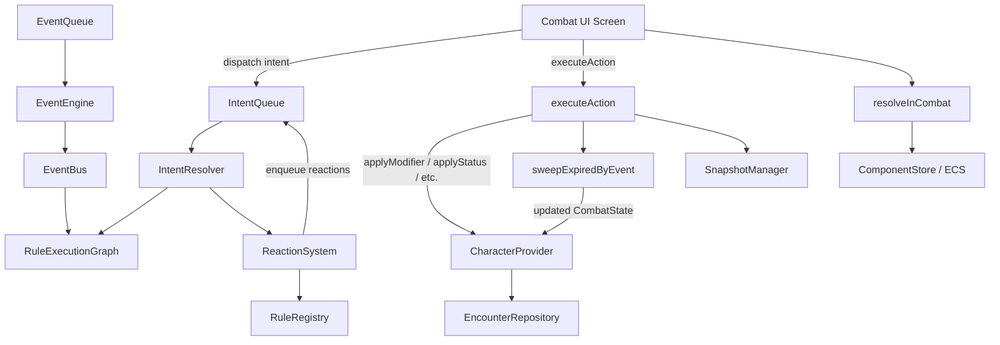
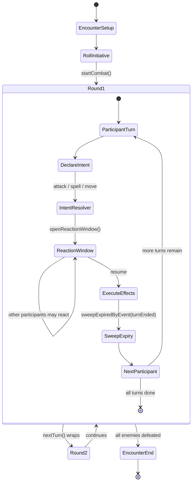

# Combat Engine Architecture

The combat engine is composed of several decoupled subsystems. This document describes each one and how they interact during a combat encounter.

---

## Subsystem Map



---

## 1. Event System (`src/core/systems/events/`)

The event system is a typed pub/sub bus that decouples state mutations from side effects.

### Components

| Component | Responsibility |
|---|---|
| `EventQueue` | Ordered FIFO queue of `QueuedEvent`s (type + payload) |
| `EventEngine` | Drains the queue, emitting each event through the `EventBus` in BEFORE → MAIN → AFTER phases |
| `EventBus` | Typed emitter: `on(eventType, handler)` and `emit(eventType, payload)` |
| `EventPhase` | `"BEFORE"` / `"MAIN"` / `"AFTER"` |

### `GameEvent` (in `src/core/entities/modifiers/Event.ts`)

| Event | When |
|---|---|
| `COMBAT_START` | Encounter initialized |
| `ROUND_START` / `ROUND_END` | Round boundary |
| `TURN_START` / `TURN_END` | Each participant's turn |
| `EFFECT_APPLIED` / `EFFECT_REMOVED` | Modifier applied/expired |
| `STATS_RECALCULATED` | After stat resolver runs |
| `ENTITY_MOVED` | Position change |
| `ENTER_AURA` / `EXIT_AURA` | Aura boundary |
| `COMBAT_END` | Encounter resolved |

**Turn boundary expiry** is driven by `TURN_START`/`TURN_END` events. Subscribers call `sweepExpiredByEvent` on the relevant participant's `CombatState` when they receive these events.

---

## 2. ECS Component Store (`src/core/systems/ecs/`)

A lightweight Entity-Component System used for O(1) per-entity effect and modifier lookups in large encounters.

| Component | Responsibility |
|---|---|
| `ComponentStore<T>` | Generic `Map<entityId, T>` with `add`/`get`/`remove`/`entries` |
| `EntityRegistry` | Maps entity IDs to component stores |
| `EffectComponent` | An ECS component wrapping active effects |
| `EcsWorld` | Root that holds all registries |

The ECS is currently used for runtime effect tracking at the systems layer. The persistence-layer `CombatState` remains the source of truth — the ECS is a performance optimization for large encounter lookups.

---

## 3. State Snapshot & Replay (`src/core/systems/state/`)

Provides undo/replay capability by capturing `EngineSnapshot`s of the full `EncounterState` on each significant state transition.

```typescript
interface EngineSnapshot {
  id: string;
  timestamp: number;
  tickInfo: number;
  triggerEvent?: QueuedEvent;  // the event that caused this snapshot
  state: EncounterState;        // the full combat state at this point in time
}
```

| Component | Responsibility |
|---|---|
| `SnapshotManager` | Maintains a capped history (`historyLimit`) of `EngineSnapshot`s |
| `ReplayEngine` | Replays a sequence of snapshots to reconstruct state at any point |
| `EventLog` | Ordered record of `GameEvent`s for audit/display |

---

## 4. Initiative System (`src/core/systems/combat/initiative-system.ts`)

Handles initiative roll collection, tie-breaking, and turn order construction. Produces the `InitiativeState.order: string[]` array used by `startCombat` and `nextTurn`.

---

## 5. Combat Engine Functions (`src/core/systems/combat/combatEngine.ts`)

Pure functions operating on `EncounterState` (the systems-layer shape — distinct from the persistence-layer shape; see Known Issues in `architecture.md`):

```typescript
function startCombat(participants, initiative, queue?): EncounterState
function nextTurn(state, queue?): EncounterState
function resolveHybridAttackRoll(config: EngineConfig): number
function dispatchEvent(state, event): EncounterState
```

`startCombat` enqueues `COMBAT_START`, `ROUND_START`, and the first `TURN_START` event into the optional `EventQueue`. `nextTurn` enqueues `TURN_END`, and conditionally `ROUND_END`/`ROUND_START`, before returning the next state.

---

## 6. Action Economy (`src/core/systems/combat/action-economy/`)

`economy-manager.ts` handles reading and decrementing action economy slots (`action`, `bonusAction`, `reaction`) on `CombatState.actionEconomy`. It is called by `executeAction` after all effects are applied.

`combat-triggers.ts` contains `onActionTaken(character, actionId)` which fires `sweepExpiredByEvent` for the `{ type: "actionTaken", actionId }` event — this handles `onAnyAction` and `onSpecificAction` expiry conditions.

---

## 7. Action Execution Pipeline

`executeAction` in `src/core/systems/combat/action-execution/take-action.ts` is the main entry point for processing a player's decision. See [`docs/engine.md#2-action-execution`](engine.md#2-action-execution) for the full effect-by-effect breakdown.

### Effect Application Helpers

All helpers in `take-action.ts` return a new `Character` (immutable — no mutation):

| Helper | What it modifies |
|---|---|
| `applyResourceDelta(character, resourceId, amount)` | `character.resources[id].current` |
| `applyResourceConversion(character, effect)` | Two resource currents atomically |
| `applyRuntimeModifier(character, modifier, expiry?)` | `combatState.runtimeModifiers` |
| `applyRuntimeAdvantage(character, nodeId, polarity, sourceId, expiry?)` | `combatState.runtimeAdvantageInstances` |
| `isActionAvailable(character, action)` | (read-only) checks economy + resource cost |

`applyStatus` and status removal (`removeStatusesById`, `revokeRuntimeEffectsBySource`, `cascadeStatusRemoval`) live in `src/core/rules/combat/runtime-effects-helper.ts`.

---

## 8. Modifier Engine (`src/core/systems/combat/modifierEngine.ts`)

Bridges the event system and the stat resolver: subscribes to `EFFECT_APPLIED`/`EFFECT_REMOVED`/`STATS_RECALCULATED` events and triggers stat recalculation as needed. Currently partially scaffolded — full integration with the event-driven stat invalidation loop is pending.

---

## Combat Flow Reference



---

## Key Invariants

1. **Never mutate `CombatState` directly.** All helpers return new objects (immutable updates). Screens save mutations through `saveEncounter`, not by modifying the state in place.
2. **Expiry sweeps go through `sweepExpiredByEvent`.** Never filter `runtimeModifiers`, `runtimeAdvantageInstances`, or `statuses` by hand.
3. **`onActionTaken` fires before effect resolution.** `onAnyAction` expiry conditions are processed at the start of `executeAction`, not after. This matches the 5e rule that effects like Blur end at the start of your next action, not during it.
4. **`resolveInCombat` is the source of truth for final stat values during combat.** Never read from `character.statModifiers` directly in UI — always go through the stat resolver.
5. **`initializeCoreSystems()` must run before any rule or registry lookup.** This is required before `IntentResolver` can be constructed, since `ReactionSystem` queries `ruleRegistry`.
