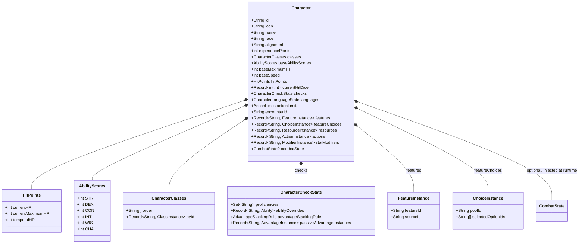
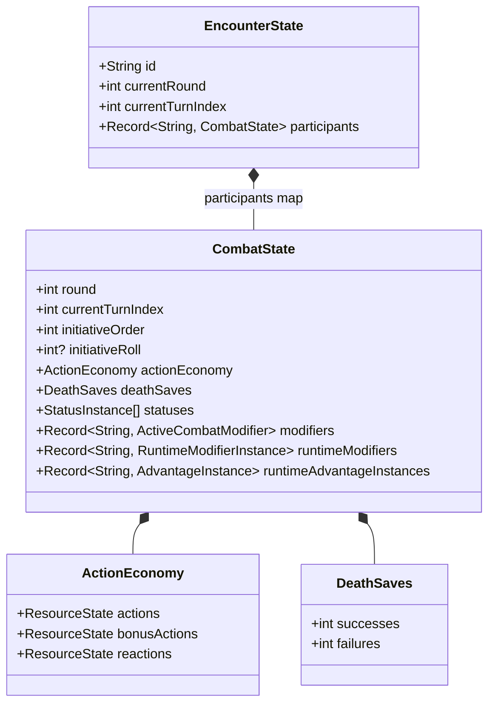
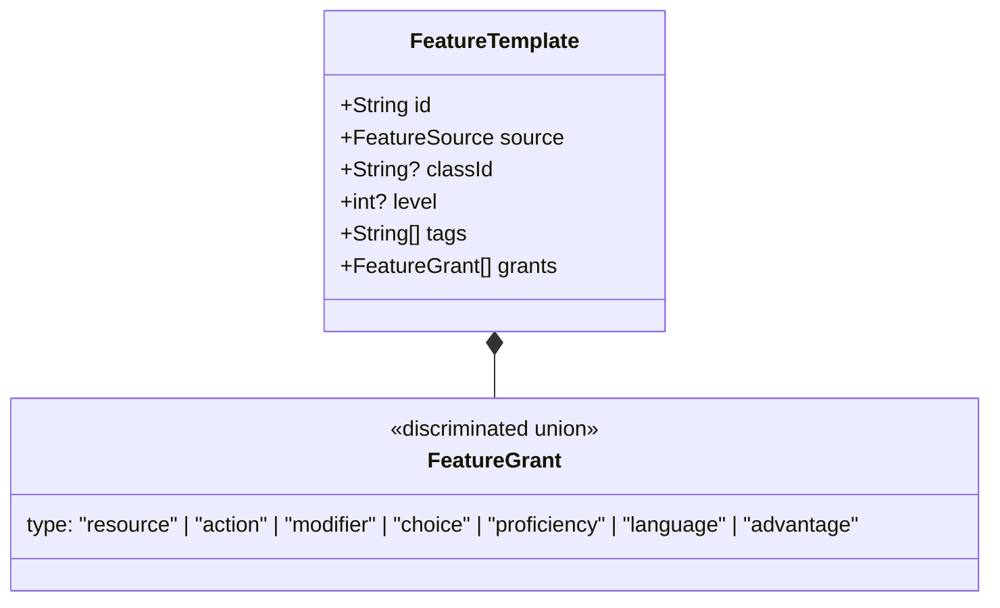
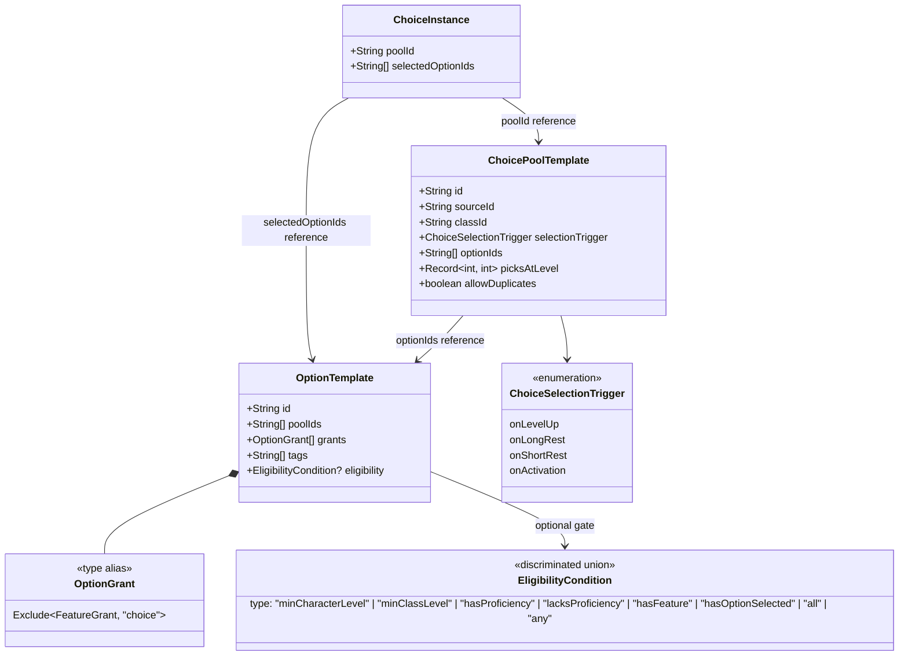
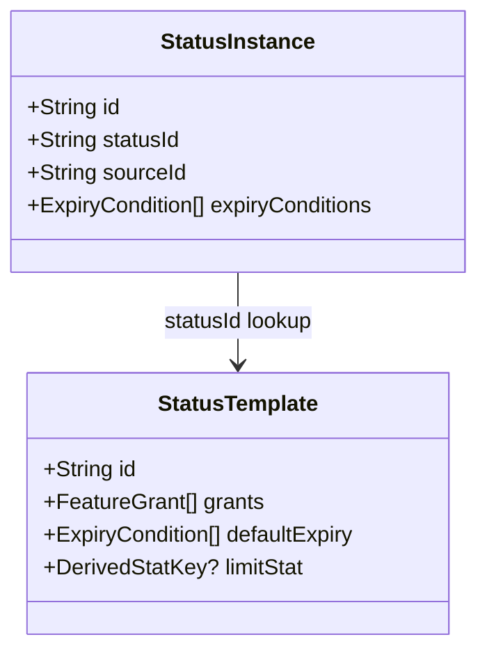
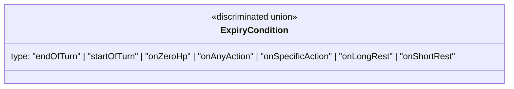

# Domain Model

This document outlines the core business entities within the `src/core/entities` engine.

---

## The Character Entity

The central object representing a player character. It is a plain TypeScript data object — no class instances, no methods. All behavior lives in `src/core/rules/` pure functions.

### Feature Pipeline

A character's active capabilities (actions, resources, modifiers, proficiencies, languages, advantages) derive from two sources merged before resolution:

1. **Class/subclass levels** — features from `CharacterClasses` walked up to current level via `getFeaturesFromClasses()`.
2. **Direct character features** — `character.features` holds `FeatureInstance` records for homebrew feats, racial features, training features, or any capability granted outside the class level pipeline.

Both sources produce `FeatureTemplate[]` which feed the same `grants` resolution pipeline. A homebrew feature is resolved identically to a class feature. `getActiveFeatures(character)` is the single entry point.

### Choice Pipeline

`character.featureChoices` records which options the character has selected from each pool, keyed by `poolId`. The `choices-helper.ts` functions resolve these selections into the same ID sets (resources, actions, modifiers, proficiencies, advantages) that feed the build pipeline. All selections are always editable regardless of the pool's `selectionTrigger`.

### Check & Proficiency Model

`character.checks` is a `CharacterCheckState`:
- `proficiencies: Set<string>` — CheckNode IDs at which the character has proficiency. A proficiency at a parent node (e.g. `savingThrow.STR`) automatically covers all descendants.
- `abilityOverrides: Record<string, Ability>` — per-node ability overrides (e.g. Deception using STR instead of CHA).
- `advantageStackingRule: "raw" | "oneToOne"` — governs how multiple advantage/disadvantage instances stack. `"raw"` = any advantage + any disadvantage = none. `"oneToOne"` = instances cancel one-for-one and the remainder wins.
- `passiveAdvantageInstances` — keyed advantage grants from features and selected options; rebuilt on every character save.

### Language Model

`character.languages: CharacterLanguageState` is `Record<string, Set<LanguageMode>>`, where `LanguageMode` is `"speak" | "read" | "write"`. Language node IDs form their own DAG in the language registry. `resolveLanguageMode(character, nodeId, mode)` walks the ancestry chain.

### Runtime vs. Persistent State

`character.combatState` is **never saved to AsyncStorage**. It is injected at runtime by `CharacterProvider` from `EncounterState.participants[character.id]`. Saving combat mutations goes through `saveEncounter`, not `saveCharacter`.

---

## The Encounter Entity

Manages the combat state for all participants in an encounter.

`CombatState` is owned by `EncounterState`, not by `Character`. It is injected into `character.combatState` at runtime by `CharacterProvider` and must never be persisted as part of the `Character` record.

**Three modifier stores on `CombatState`:**
| Field | Type | Purpose |
|---|---|---|
| `runtimeModifiers` | `Record<string, RuntimeModifierInstance>` | Active timed modifiers (buffs, debuffs) with expiry conditions |
| `runtimeAdvantageInstances` | `Record<string, AdvantageInstance>` | Active timed advantage/disadvantage grants with expiry conditions |
| `statuses` | `StatusInstance[]` | Active D&D conditions (Poisoned, Grappled, etc.) that cascade modifiers and advantages via the status registry |

---

## The Feature System

Features are the mechanism by which classes, subclasses, races, feats, and homebrew content grant capabilities to a character. Features exist to grant actions, resources, modifiers, proficiencies, languages, advantages, and choice pools — they are not mechanical actors themselves.

`source` is `"class" | "subclass" | "race" | "feat" | "background" | "other"`.

Always use `grantsOfType(feature.grants, "x")` from `src/core/rules/shared/grant-filters.ts` when filtering grants — it provides proper TypeScript narrowing for the full union including `proficiency` (which has `nodeId` instead of `id`).

---

## The Option System

For features that offer a pool of selectable options (Fighter Runes/Maneuvers, Eldritch Invocations, Metamagic, Fighting Styles), three cooperating types model the full lifecycle from pool definition to character selection.

**Key design decisions:**

- `OptionGrant` is `Exclude<FeatureGrant, { type: "choice" }>` — options can grant resources, actions, modifiers, proficiencies, languages, and advantages, but **cannot** grant further choice pools. This prevents circular resolution.
- `OptionTemplate.poolIds` is a string array — an option can belong to multiple pools (e.g. `fighting_style_defense` is valid for Fighter, Paladin, Ranger, and Swords Bard). Each class defines its own pool restricting which options it includes.
- `OptionTemplate.eligibility` is an optional `EligibilityCondition` gate. `getEligibleOptionsForPool(character, poolId)` filters the pool's options by this condition automatically.
- Shared options (fighting styles, etc.) live in `src/core/data/rules/options/shared/` and are imported only by the root `options.ts` aggregator.
- `bootstrapFeatureChoices(character)` seeds `character.featureChoices` for all currently-granted pools. It never overwrites existing selections. It also prunes pools no longer granted by any active feature. Call it on every character save.
- `resetChoicesForTrigger(character, trigger)` clears `selectedOptionIds` for all pools with the matching `selectionTrigger`. Used during long/short rest flows.

---

## The Status System

D&D conditions (Poisoned, Grappled, Paralyzed, etc.) are modeled as `StatusInstance`s on `CombatState.statuses`. A `StatusTemplate` in the status registry declares what the condition grants (modifiers, advantages) via the standard `grants: FeatureGrant[]` mechanism.

- `StatusInstance.id` is `${statusId}:${sourceId}`, so re-applying the same condition from the same source refreshes (replaces) it rather than stacking.
- `getStatusModifierInstances(character)` and `getStatusAdvantageInstances(character)` extract the active effects for inclusion in the modifier pool and advantage resolution respectively.
- `cascadeStatusRemoval` in `runtime-effects-helper.ts` handles any cleanup side-effects when a status expires (e.g. removing modifier instances that were explicitly bound to that status).

---

## The Expiry System

All timed effects (runtime modifiers, runtime advantage instances, statuses) use `ExpiryCondition[]` to declare when they expire.

`sweepExpiredByEvent(combatState, event)` in `expiry-helper.ts` is the single authoritative function that clears expired `runtimeModifiers`, `runtimeAdvantageInstances`, and `statuses` in one pass. Call sites should never filter these records manually.

`buildExpiryConditions(currentRound, durationRounds, endsAt, endsEarlyOn)` is the factory for constructing expiry arrays from action effects.
