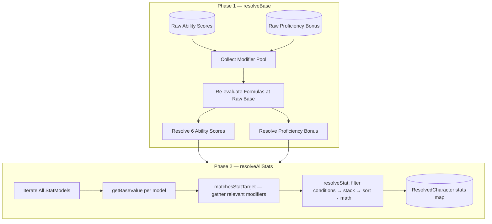
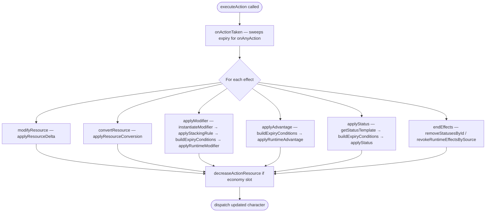

# Core Engine Mechanics

This document details the critical computation flows within the isolated `src/core` D&D Engine. See [`docs/rules-system.md`](rules-system.md) for the rule definition / execution graph pipeline and [`docs/modifier-system.md`](modifier-system.md) for the full modifier model.

---

## 1. Character Stat Resolution

The stat resolver computes a character's final numbers by combining their base stats with all active modifiers. It runs in two phases.

### Phase 1 — Base Resolution (`resolveBase`)

`resolveBase(character, runtimeModifiers?)` in `src/core/entities/rules/resolved-base.ts`:

1. Computes the raw ability scores and proficiency bonus from the character record.
2. Collects the full modifier pool: `character.statModifiers` + status-derived modifiers + any runtime combat modifiers passed in.
3. Re-evaluates formula-based modifier values against the **raw** base (formulas cannot see each other here — no circular dependency).
4. Resolves the six ability scores and proficiency bonus, applying stacking rules and the priority-ordered math pipeline.
5. Returns `{ base: ResolvedBase, stats: Map<string, ResolvedStat> }`.

`ResolvedBase` (`{ abilityScores, proficiencyBonus }`) is then passed as input to Phase 2.

### Phase 2 — Full Stat Resolution (`resolveAllStats`)

Called via `resolveOutOfCombat(character)` or `resolveInCombat(character, encounterState)`:

1. Iterates every registered `StatModel`: all `check` nodes (skills, saves, tools), all `derived` keys (`maxHp`, `speed`, `initiative`, `ac`, `spellAttackModifier`, `spellSaveDC`, `concentrationLimit`, `proficiencyBonus`), and all `spellcasting` sources.
2. For each model, computes the base value (`getBaseValue`) using the `ResolvedBase` from Phase 1.
3. Gathers matching modifiers from the refreshed pool via `matchesStatTarget`.
4. For `check`-type stats, re-evaluates formula modifiers with `targetNodeId` injected so that per-node formulas (e.g. Fire Rune: "add PB only for proficient tools") resolve correctly per node.
5. Applies `resolveStat` — condition filtering → stacking rules → priority-sorted math pipeline.
6. Returns `ResolvedCharacter { stats: Map<string, ResolvedStat> }`.

### The `resolveStat` Math Pipeline

`resolveStat(statId, baseValue, modifiers, evaluationContext)` in `src/core/systems/stats/resolve-stats.ts`:

1. Filter modifiers whose `condition` is satisfied by the `EvaluationContext`.
2. Apply stacking rules (`applyStackingRules`): modifiers with the same `effectId` keep only the strongest (or lowest for `CAP`). Modifiers without `effectId` are independent.
3. Sort by `priority` ascending.
4. Apply math in priority order:

| `ModifierType` | Operation |
|---|---|
| `SET` | `finalValue = mod.value` |
| `MULTIPLICATIVE` | `finalValue *= mod.value` |
| `ADDITIVE` | `finalValue += mod.value` |
| `FLOOR` | `finalValue = Math.max(finalValue, mod.value)` |
| `CAP` | `finalValue = Math.min(finalValue, mod.value)` |

Default priorities: `SET=100, MULTIPLICATIVE=200, ADDITIVE=300, FLOOR=400, CAP=500`. Lower number runs first.

The result is floored to an integer: `Math.floor(finalValue)`.

---

## 2. Action Execution

`executeAction(action, { character, dispatch })` in `src/core/systems/combat/action-execution/take-action.ts` is the synchronous, pure function that applies a single action's effects to a character and dispatches the updated character.

### `ActionInstance` Effect Types

| Effect type | What it does |
|---|---|
| `modifyResource` | Adds/subtracts from `character.resources[resourceId].current` |
| `convertResource` | Transfers an amount from one resource to another |
| `applyModifier` | Instantiates `ModifierTemplate`(s), applies stacking policy, injects into `combatState.runtimeModifiers` with expiry |
| `applyAdvantage` | Injects `AdvantageInstance`(s) into `combatState.runtimeAdvantageInstances` with expiry |
| `applyStatus` | Applies a `StatusInstance` to `combatState.statuses`; respects `limitStat` cap |
| `endEffects` | Removes statuses by `statusId` and/or revokes all runtime effects from given `sourceId`s |

### `ActionDuration`

`action.duration` replaces the old `actionSlot` field:
- `{ kind: "economy"; slot: "action" | "bonusAction" | "reaction" }` — consumes an action economy slot.
- `{ kind: "free" }` — no slot consumed.

### `ActionBoard`

`action.boards: ActionBoard[]` declares where the action renders in the UI (combat board, character sheet, etc.). This is purely a UI concern — it has no effect on economy or rule resolution.

---

## 3. Combat Turn Flow

The `EncounterState` (persistence shape) tracks `currentRound`, `currentTurnIndex`, and `participants: Record<string, CombatState>`. Turn advancement is handled by the UI layer updating these fields and calling `saveEncounter`.

Expiry sweeps on `CombatState` happen at turn events:
- **`turnStarted`** — sweeps modifiers/advantages/statuses with `startOfTurn` expiry at the current round.
- **`turnEnded`** — sweeps those with `endOfTurn` expiry.
- **`longRest`** / **`shortRest`** — sweeps rest-scoped effects via `sweepExpiredByEvent`.

All sweeps go through `sweepExpiredByEvent(combatState, event)` in `expiry-helper.ts`. Never filter `runtimeModifiers`, `runtimeAdvantageInstances`, or `statuses` manually.

---

## 4. Advantage Resolution

`resolveAdvantageState(character, nodeId)` in `src/core/rules/character/advantage-helper.ts` returns `"advantage" | "disadvantage" | "none"` for a given CheckNode:

1. Collects all applicable `AdvantageInstance`s across three sources:
   - `character.checks.passiveAdvantageInstances` (permanent + feature-derived grants)
   - `character.combatState.runtimeAdvantageInstances` (timed combat grants)
   - Status-derived advantage from `getStatusAdvantageInstances(character)`
2. Filters to instances whose `nodeId` is in the CheckNode ancestry chain.
3. Filters by `condition` (using `evaluateCondition`).
4. Applies the `advantageStackingRule`:
   - `"raw"`: any advantage + any disadvantage → `"none"`.
   - `"oneToOne"`: instances cancel one-to-one; remainder wins.

Passive advantage instances are rebuilt on every character save by `buildCharacterAdvantageInstances(character)`, which merges feature-derived and choice-derived grants over the preserved manual instances. Feature/option-sourced instances are fully replaced (deterministic re-derive), manual instances are preserved.

---

## 5. Resting

`takeLongRest(character)` and `takeShortRest(character)` in `src/core/rules/character/resting.ts` produce a new `Character` (no mutation). Long rest resets HP, hit dice, and all `onLongRest` choice pools. Short rest resets `onShortRest` choice pools and optionally hit dice.

`sweepExpiredByEvent(combatState, { type: "longRest" })` and `{ type: "shortRest" }` must be called on the active `CombatState` as part of the rest flow to clear any combat effects scoped to the rest type.
