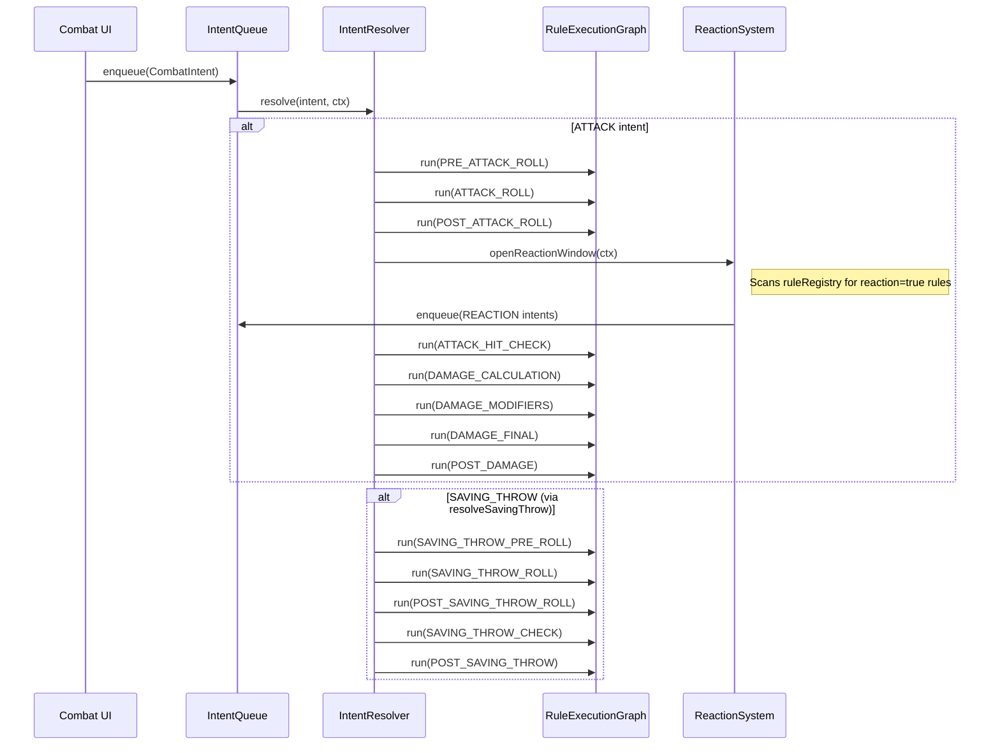

# Rules System

This document covers the rule definition pipeline: how game rules are authored, registered, looked up, and executed during combat resolution.

---

## Overview

The rules system is a **data-driven execution pipeline** where game rules are defined as TypeScript objects (`RuleDefinition`), loaded into a registry (`RuleRegistry`), and invoked through a priority-ordered execution graph (`RuleExecutionGraph`) at specific lifecycle nodes (`ExecutionNode`).

```mermaid
flowchart LR
    RuleFiles["src/rules/**/*.rule.ts\n(hand-written)"]
    Generated["src/rules/rules.generated.ts\n(GENERATED)"]
    Registry["RuleRegistry\n(singleton)"]
    Graph["RuleExecutionGraph\n(per-encounter)"]
    Resolver["IntentResolver"]

    RuleFiles -->|compile-rules.ts| Generated
    Generated -->|initializeCoreSystems| Registry
    Registry -->|getRulesForNode| Graph
    Resolver -->|graph.run(node, ctx)| Graph
```

---

## `RuleDefinition`

Defined in `src/core/rules/rule-definition.ts`.

```typescript
interface RuleDefinition {
  id: string;
  domain: RuleDomain;        // "spell" | "feat" | "condition" | "class-feature" | "item"
  triggers: ExecutionNode[];  // which lifecycle nodes activate this rule
  tags?: string[];
  priority?: number;          // lower = runs first; default 10
  reaction?: boolean;         // true = available as a reaction window candidate
  condition?: string;         // key on RuleContext; rule skips if context[condition] is falsy
  handler: RuleHandler;
}
```

A `RuleDefinition` is stateless data. It declares **when** to run (via `triggers`), **what condition** must hold (via `condition`), and **what to do** (via `handler`). No mutable state, no React.

---

## `ExecutionNode`

Defined in `src/core/rules/execution/execution-node.ts`. The enum keys that rules subscribe to:

| Category | Nodes |
|---|---|
| Attack | `PRE_ATTACK_ROLL`, `ATTACK_ROLL`, `POST_ATTACK_ROLL`, `ATTACK_HIT_CHECK` |
| Damage | `DAMAGE_CALCULATION`, `DAMAGE_MODIFIERS`, `DAMAGE_FINAL`, `POST_DAMAGE` |
| Saving Throw | `SAVING_THROW_PRE_ROLL`, `SAVING_THROW_ROLL`, `POST_SAVING_THROW_ROLL`, `SAVING_THROW_CHECK`, `POST_SAVING_THROW` |

---

## `RuleHandler` and `RuleContext`

Defined in `src/core/rules/execution/rule-handler.ts`.

```typescript
interface RuleHandler {
  id: string;
  node: ExecutionNode;
  priority: number;
  execute: (context: RuleContext) => void;
}

interface RuleContext {
  targetId?: string;
  reactionTriggered?: string;
  savingThrow?: { ... };
  [key: string]: unknown;  // open for rule-specific context keys
}
```

`RuleContext` is mutable — handlers add or modify fields during execution. This is intentional: each node in the attack chain may read and write shared context (e.g., `POST_ATTACK_ROLL` handlers can read the roll result set by `ATTACK_ROLL`).

---

## `RuleExecutionGraph`

Defined in `src/core/rules/execution/execution-graph.ts`.

```typescript
class RuleExecutionGraph {
  register(handler: RuleHandler): void;
  run(node: ExecutionNode, context: RuleContext): void;
}
```

- `register` inserts the handler into its node's list, then re-sorts by `priority`.
- `run` executes all handlers registered at that node, in priority order. Handlers cannot interrupt each other — all registered handlers for a node always run.

---

## `RuleRegistry`

The singleton `ruleRegistry` in `src/core/rules/dsl/rule-registry.ts` is the authoritative in-memory store of all rules. It maintains three indexes:

| Index | Key | Query method |
|---|---|---|
| id map | `rule.id` | `getById(id)` |
| node index | `ExecutionNode` | `getRulesForNode(node)` |
| tag index | each tag string | `getRulesByTag(tag)` |
| domain index | `RuleDomain` | `getRulesByDomain(domain)` |

`ruleRegistry.registerAll(ALL_RULES)` is called once by `initializeCoreSystems()`.

---

## Authoring a Rule

1. Create `src/rules/<domain>/<name>.rule.ts`.
2. Export a named const `<name>Rule: RuleDefinition`:

```typescript
// src/rules/spells/bless.rule.ts
import { RuleDefinition } from "@/core/rules/rule-definition";
import { ExecutionNode } from "@/core/rules/execution/execution-node";

export const blessRule: RuleDefinition = {
  id: "bless",
  domain: "spell",
  triggers: [ExecutionNode.ATTACK_ROLL, ExecutionNode.SAVING_THROW_ROLL],
  tags: ["concentration"],
  priority: 5,
  handler: {
    id: "bless",
    node: ExecutionNode.ATTACK_ROLL, // handler.node must match a trigger
    priority: 5,
    execute: (ctx) => {
      // ctx is mutated here: add 1d4 to the roll, etc.
    },
  },
};
```

3. Run `ts-node scripts/compile-rules.ts` to regenerate `src/rules/rules.generated.ts`.

> **Never edit `src/rules/rules.generated.ts` by hand.**

---

## The `RuleDSL`

For rules that can be expressed as structured data (modifiers with conditions and durations), a TypeScript/Zod DSL is available in `src/core/rules/dsl/dsl-types.ts`:

```typescript
const RuleDSLLayout = z.object({
  id: z.string(),
  type: z.enum(["spell", "feature", "condition"]),
  trigger: z.nativeEnum(ExecutionNode).optional(),
  condition: z.string().optional(),
  reaction: z.boolean().optional(),
  duration: z.object({ type: z.enum(["rounds", "turns", "permanent"]), value: z.number().optional() }).optional(),
  modifiers: z.array(ModifierDSLLayout).optional(),
  stacking: z.enum(["highest", "stack"]).optional(),
  tags: z.array(z.string()).optional(),
});
```

`registerRuleInGraph(rule, graph, onExecuteEffect)` in `dsl-parser.ts` parses a `RuleDSL` object and registers it in the execution graph. This is useful for rules authored programmatically without needing to register a full `RuleDefinition`.

> **Note:** There is no YAML DSL. Earlier documentation mentioned YAML rule files — these were never implemented. The DSL is TypeScript/Zod only.

---

## Intent-Based Action Resolution

`IntentResolver` in `src/core/combat/intents/intent-resolver.ts` orchestrates the execution graph for a complete combat action.



### `CombatIntent`

```typescript
interface CombatIntent {
  id: string;
  type: IntentType;    // ATTACK | CAST_SPELL | MOVE | READY_ACTION | REACTION
  actorId: string;
  targetId?: string;
  payload?: { ruleId?: string; [key: string]: unknown };
}
```

### `IntentQueue`

A simple FIFO queue (`enqueue` / `next` / `peek` / `getAll`). Reaction intents are inserted by `ReactionSystem.openReactionWindow()` during attack resolution — the resolver continues only after processing the reaction window.

### `ReactionSystem`

`ReactionSystem.openReactionWindow(ctx)` scans `ruleRegistry.getAllRules()` for rules with `reaction: true` whose `condition` field is satisfied by the current `RuleContext`. Each matching rule becomes a `REACTION` intent enqueued in the `IntentQueue`. The resolver then processes those intents (e.g. casting Shield to modify AC before the hit check).
